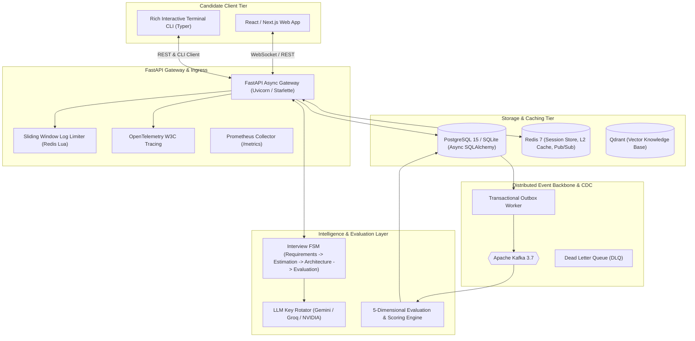

# Archon 🏛️ (FastAPI Edition)
### AI-Native Distributed System Design Interview & Evaluation Platform

[](https://fastapi.tiangolo.com)
[](https://python.org)
[](https://www.postgresql.org)
[](https://redis.io)
[](https://kafka.apache.org)
[](https://opentelemetry.io)

---

## 📌 Overview

**Archon FastAPI** is an enterprise-grade, end-to-end reimplementation of the Archon System Design Interview platform, rewritten completely in **Python & FastAPI**.

Combining asynchronous high-performance I/O, domain-driven design (DDD), real-time interactive whiteboards over WebSockets, transactional event streaming (Outbox + Kafka), multi-provider LLM orchestration (Gemini, Groq, NVIDIA), and vector knowledge search (Qdrant), Archon conducts and evaluates Senior and Staff-level System Design interviews with rigorous technical fidelity.

---

## 🏛️ System Architecture



---

## ⚙️ Core Engines & Bounded Contexts

1. **Authentication & Identity (`app/domains/auth`)**:
   - Secure bcrypt password hashing, JWT with token versioning, revocation, and OAuth2.
2. **Interview Lifecycle Engine (`app/domains/interview`)**:
   - Manages candidate sessions, time limits, question selection, and phase transitions.
3. **Interactive Whiteboard & Context Fusion (`app/domains/diagram`)**:
   - Real-time nodes and edges streaming over WebSockets, converting architectural diagrams into LLM prompts.
4. **AI Socratic Interviewer & FSM (`app/domains/ai`)**:
   - Multi-agent conversational FSM (`REQUIREMENTS` $	o$ `ESTIMATION` $	o$ `HIGH_LEVEL` $	o$ `DEEP_DIVE` $	o$ `COMPLETED`).
5. **Evaluation & Scorecard Engine (`app/domains/reports`)**:
   - Scores candidates across 5 core dimensions: Requirements, Estimation, Architecture, Data Modeling, and Scalability.
6. **Quiz Bank & Daily Architecture Challenge (`app/domains/quiz`)**:
   - Two-tier cached quiz decks with instant answer verification and explanations.
7. **Candidate Intelligence & Analytics (`app/domains/analytics`, `app/domains/dashboard`)**:
   - 5-axis radar charts, readiness scores, and streak tracking.

---

## ⚡ Quick Start

### 1. Installation
```bash
python3 -m venv .venv
source .venv/bin/activate
pip install -r requirements.txt
```

### 2. Seed Database
```bash
python -m app.cli seed
```

### 3. Run FastAPI Server
```bash
uvicorn app.main:app --host 0.0.0.0 --port 8080 --reload
```

### 4. Interactive CLI Testing
```bash
# List available system design questions
python -m app.cli questions

# Register a candidate
python -m app.cli register "Agrim Dubey" "agrimdubey37@gmail.com" "SecurePass123!"

# Start an interview session
python -m app.cli start q-whatsapp-01

# View quiz decks and daily challenge
python -m app.cli quiz
```

### 5. Run Test Suite
```bash
pytest tests/ -v
```

---

## 🧪 Testing

The repository includes a comprehensive automated test suite testing all endpoints, authentication, diagram synchronization, quiz evaluation, and CLI operations:
```bash
pytest tests/ --cov=app --cov-report=term-missing
```

---

## 📜 Authorship & License

Developed with clean code practices by **Agrim Dubey** (`agrimdubey37@gmail.com`).
Licensed under the MIT License.
